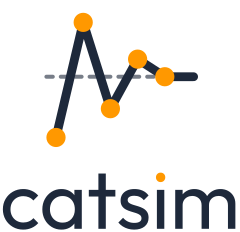

<p align="center">
  <picture>
    <source media="(prefers-color-scheme: dark)" srcset="https://raw.githubusercontent.com/douglasrizzo/catsim/dev/sphinx/logo/stacked-dark.svg" />
    
  </picture>
</p>

[](https://github.com/douglasrizzo/catsim/actions/workflows/ci-cd.yml)
[](https://codecov.io/github/douglasrizzo/catsim)
[](https://pypi.org/project/catsim/)
[](https://doi.org/10.5281/zenodo.46420)

_catsim_ is a Python package for computerized adaptive testing (CAT) with item response theory. It
computes each step of an adaptive test and runs simulation studies that compare methods of item
selection, ability estimation and stopping, and applications can use the same computations to give
adaptive tests.

> ⚠️ **This version of catsim breaks code written for catsim 0.21.0 and earlier.** That code
> needs changes to run, and seeded simulations give different numbers. To keep using it, install
> `catsim==0.21.0`, documented at the [0.21.0 tag](https://github.com/douglasrizzo/catsim/tree/0.21.0).
> The [release notes](https://github.com/douglasrizzo/catsim/releases) list every change.

## Installation

```bash
pip install catsim
```

The plotting functions in `catsim.plot` need matplotlib, which the `plot` extra installs:

```bash
pip install 'catsim[plot]'
```

_catsim_ supports Python 3.11 to 3.15.

## Quickstart

This simulates adaptive tests for 200 examinees on a generated bank of 100 items. Each test gives
the item with the most information at the current ability estimate, and stops once the estimate's
standard error is at most 0.5, or after 20 items.

```python
import numpy
from catsim import CatEngine, ItemBank, simulate
from catsim.estimation import EAPEstimator
from catsim.initialization import FixedPointInitializer
from catsim.selection import MaxInfoSelector
from catsim.stopping import MaxLengthStopper, StandardErrorStopper, StopRule

engine = CatEngine(
    ItemBank.generate(100, rng=0),
    FixedPointInitializer(0.0),
    MaxInfoSelector(),
    EAPEstimator(),
    StopRule(StandardErrorStopper(0.5), MaxLengthStopper(20)),
)
true_thetas = numpy.random.default_rng(1).normal(0, 1, 200)
result = simulate(engine, true_thetas=true_thetas, rng=0)
rmse, mc_se = result.rmse()
print(f"RMSE {rmse:.3f} ± {mc_se:.3f}, mean test length {result.test_length().value:.1f}")
```

```text
RMSE 0.470 ± 0.025, mean test length 13.9
```

It prints the root mean squared error of the final estimates, with its Monte Carlo standard error,
and the mean test length: most tests reach the target before the 20-item limit. The result also
holds every examinee's test, as tables, and the same `rng` gives the same result on every run.

## Where to go next

- [Introduction to CAT and IRT](https://douglasrizzo.com.br/catsim/introduction.html), if adaptive
  testing is new to you.
- The guides: [Running simulations](https://douglasrizzo.com.br/catsim/running-simulations.html),
  [Reproducibility](https://douglasrizzo.com.br/catsim/reproducibility.html),
  [Extending catsim](https://douglasrizzo.com.br/catsim/extending.html) and
  [Embedding catsim](https://douglasrizzo.com.br/catsim/embedding-catsim.html).
- [Techniques](https://douglasrizzo.com.br/catsim/api/techniques/index.html): each initialization,
  selection, estimation and stopping method, with its formulas and sources.
- The [tutorial notebooks](https://douglasrizzo.com.br/catsim/tutorials.html), which open in Colab.
- The [API reference](https://douglasrizzo.com.br/catsim/api/index.html).
- The [architecture decision records](https://douglasrizzo.com.br/catsim/architecture_decisions.html):
  why _catsim_ is designed the way it is.

Source code and issues: <https://github.com/douglasrizzo/catsim>.

## Citing catsim

```bibtex
@article{catsim,
  author = {Meneghetti, Douglas De Rizzo and Aquino Junior, Plinio Thomaz},
  title = {Application and simulation of computerized adaptive tests through the package catsim},
  year = 2018,
  month = jul,
  archiveprefix = {arXiv},
  eprint = {1707.03012},
  eprinttype = {arxiv},
  journal = {arXiv:1707.03012 [stat]},
  primaryclass = {stat}
}
```

## Calibrating items

_catsim_ takes calibrated item parameters and does not estimate them. I calibrate items with the
[mirt](https://cran.r-project.org/package=mirt) R package. For Python, these packages estimate item
parameters, though I have not used them myself:
[girth](https://github.com/eribean/girth), [girth_mcmc](https://github.com/eribean/girth_mcmc) and
[py-irt](https://github.com/nd-ball/py-irt).
